# Intelligent Greenhouse Arch Support Insertion Machine

**Mechanical Design · Automated Rod Feeding · Material Testing · ANSYS Simulation**  
*Undergraduate team project | Northwest A&F University | Robotic competition project*

## Project Overview

Small plastic tunnels are widely used in agriculture to protect crops, improve growing conditions, and extend the growing season. Their frames are commonly formed by bending flexible support rods into arches and inserting both ends into the soil.

Installing these arches manually involves repeatedly picking up rods, bending them, positioning them along planting rows, and pushing them into the ground. The process can be physically demanding and time-consuming, especially over large planting areas where consistent spacing and insertion depth are important.

To address these challenges, our team developed an **intelligent greenhouse arch support insertion machine** that integrates rod storage, sequential feeding, arch forming, and soil insertion on a mobile platform. In addition to mechanical design and prototype fabrication, the project investigated the strength of candidate support-rod materials and the structural response of greenhouse arches to lateral wind loads.

The project aimed to **reduce repetitive manual work, improve the consistency of arch installation, and provide an engineering basis for material selection and insertion-depth design**.

## My Contributions

My main responsibilities in this undergraduate team project were **mechanical structure design, prototype fabrication and assembly, material mechanical testing and analysis, and finite element analysis (FEA) of greenhouse arches under lateral wind loading**.

- **Mechanical design:** Developed the mechanical structure and worked on the rod feeding, arch-forming, and insertion mechanisms.
- **Prototype fabrication:** Worked on manufacturing, assembling, and integrating the machine's mechanical components.
- **Material testing and analysis:** Evaluated fiberglass and PTFE rods using shear, axial compression, and bending tests, and analyzed the experimental results to support material selection.
- **Finite element analysis:** Used ANSYS to study the wind resistance of the arch structure and assess the effect of support-rod insertion depth.

The **control system and autonomous driving/navigation functions** were handled by other team members. The complete machine was developed collaboratively.

## 1. Mechanical Structure and Working Principle

### 1.1 Overall Mechanical Design

The machine integrates a mobile chassis, a rod storage and feeding unit, a rod transfer and gripping assembly, an arch-forming guide, and a vertical insertion mechanism. Its main operating sequence is **rod feeding → pickup and gripping → arch forming → transfer → insertion into soil**. This arrangement supports repeated installation of small-tunnel arches along a planting row.

<table align="center">
<tr>
<td align="center" valign="middle">
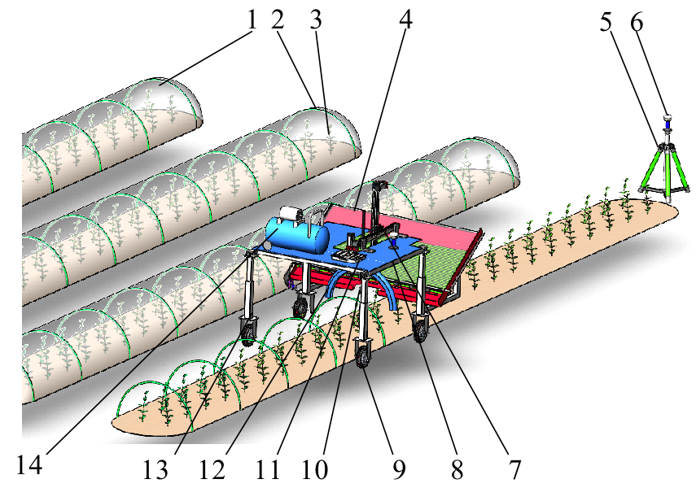 
Overall CAD assembly showing the machine, planting rows, and greenhouse arches.
</td>
<td align="center" valign="middle">
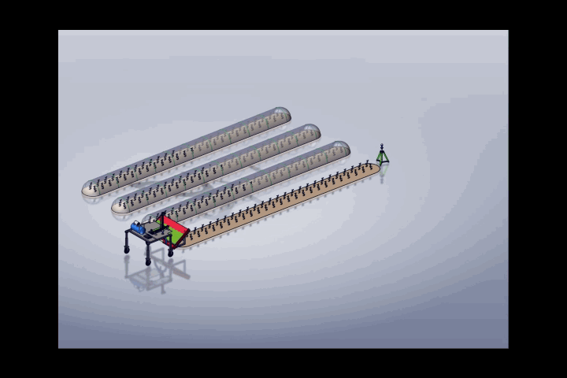 
Working process demonstration.
</td>
</tr>
</table>

View components — Overall machine (1–14)

| No. | Component | No. | Component |
|---:|---|---:|---|
| 1 | Mulch film | 8 | Load-carrying platform |
| 2 | Greenhouse support rod | 9 | Wheel hub motor |
| 3 | Crops | 10 | Rod-gripping end effector |
| 4 | Rod guide device | 11 | Control system |
| 5 | Tripod | 12 | Plastic forming cavity |
| 6 | RTK positioning system | 13 | Machine frame |
| 7 | Rod transfer gantry | 14 | Air pump |

### 1.2 Key Mechanisms

<table>
<tr>
<td width="50%" valign="top">

<strong>Rod Feeding Mechanism</strong>

The inclined guide plate directs stored rods toward a grooved wheel. A stepper motor and reducer rotate the wheel to advance the rods sequentially toward the pickup position.

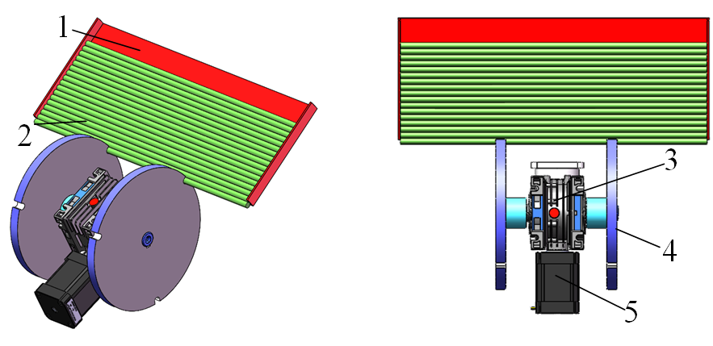

View feeding components (1–5)

<table>
<tr><th>No.</th><th>Component</th></tr>
<tr><td>1</td><td>Rod alignment plate</td></tr>
<tr><td>2</td><td>Support rod</td></tr>
<tr><td>3</td><td>Gear reducer</td></tr>
<tr><td>4</td><td>Grooved wheel</td></tr>
<tr><td>5</td><td>Stepper motor</td></tr>
</table>

</td>
<td width="50%" valign="top">

<strong>Arch Forming and Insertion Mechanism</strong>

After pickup, the rod is gripped and shaped around a forming guide. The transfer and vertical-motion assemblies bring the formed arch to its insertion position and press its ends into the soil.

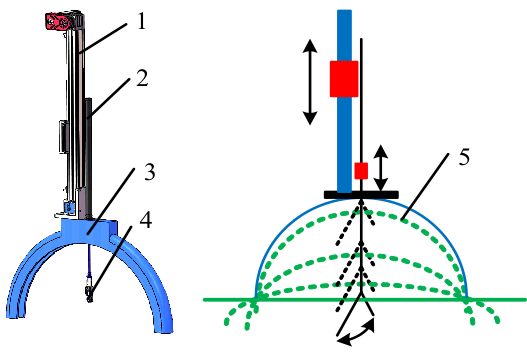

View insertion components (1–5)

<table>
<tr><th>No.</th><th>Component</th></tr>
<tr><td>1</td><td>Vertical transfer frame</td></tr>
<tr><td>2</td><td>Pneumatic cylinder</td></tr>
<tr><td>3</td><td>Arch-forming cavity</td></tr>
<tr><td>4</td><td>Rod-gripping end effector</td></tr>
<tr><td>5</td><td>Greenhouse support rod</td></tr>
</table>

</td>
</tr>
</table>

### 1.3 Mechanism Demonstrations

<table>
<tr>
<td width="50%" valign="top">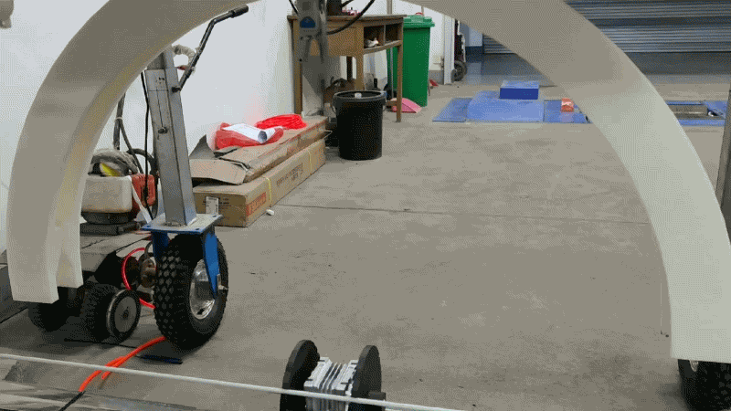 Rod feeding and positioning.</td>
<td width="50%" valign="top">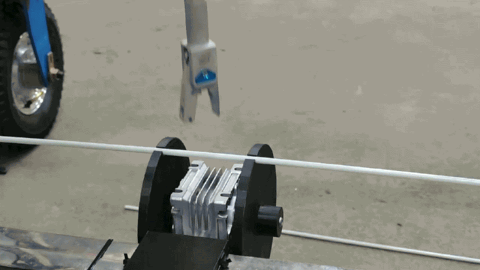 Gripping and insertion mechanism.</td>
</tr>
</table>

## 2. Support Rod Material Testing

Fiberglass and polytetrafluoroethylene (**PTFE**) rods were evaluated as candidate greenhouse support materials. The project used **shear, axial compression, and bending tests**, with three repetitions per condition, to compare load-bearing behavior and mechanical strength.

### 2.1 Experimental Setup

<table>
<tr>
<td width="33%">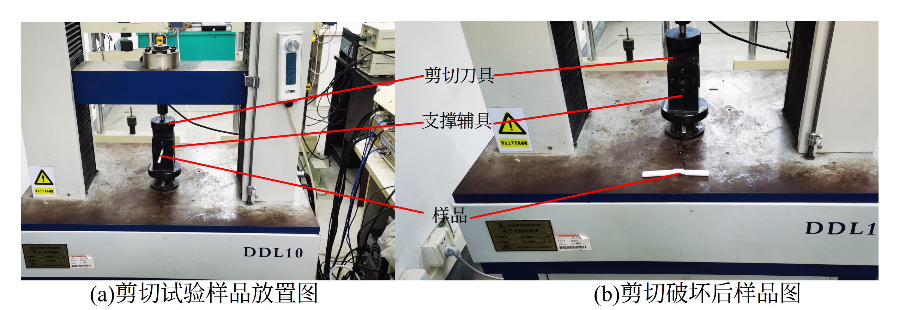 Shear test</td>
<td width="33%">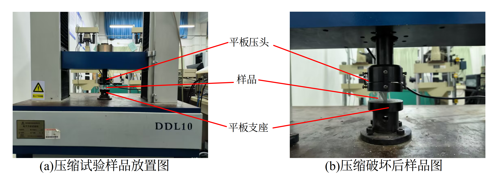 Axial compression test</td>
<td width="33%">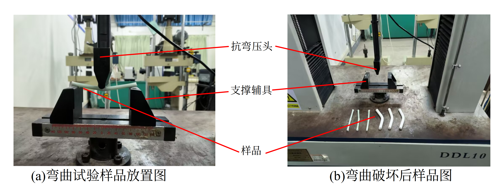 Bending test</td>
</tr>
</table>

### 2.2 Load–Displacement Results

Each curve compares **three repeated tests** (rather than three materials). The two columns below correspond to the two candidate rod materials. The images retain the original (a)–(f) labels from the project figures.

| Test | Fiberglass | PTFE |
|---|---|---|
| **Shear** | 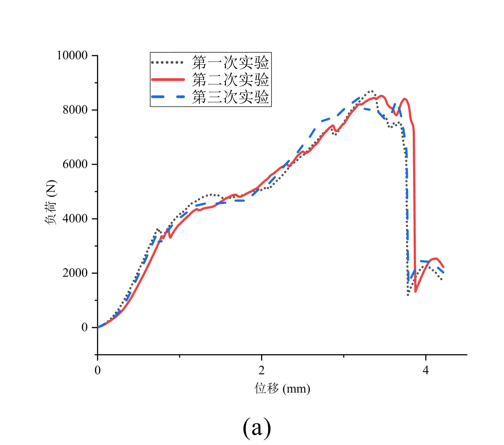 | 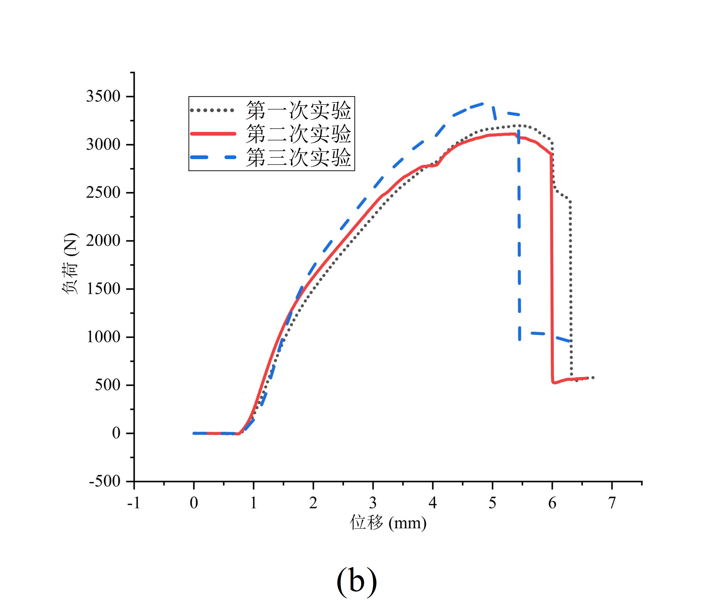 |
| **Axial compression** | 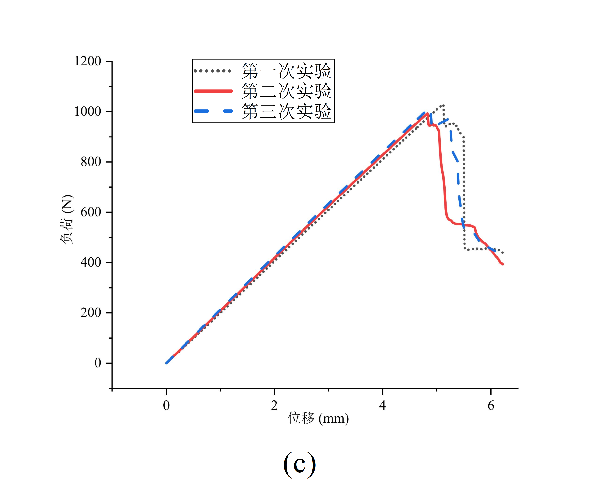 | 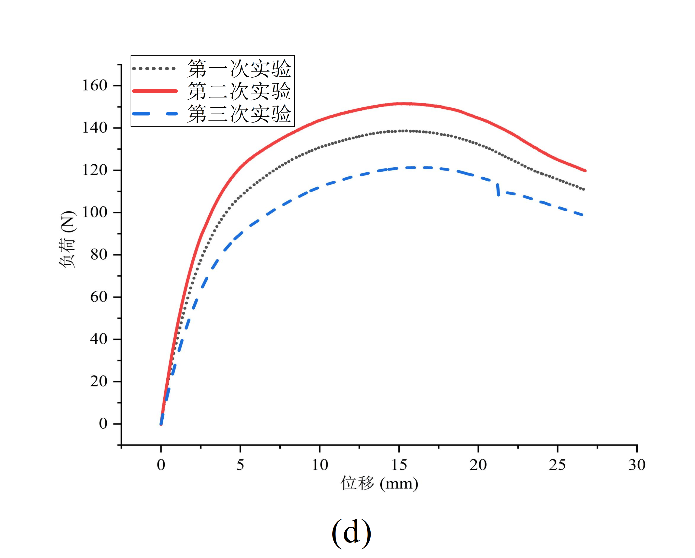 |
| **Bending** | 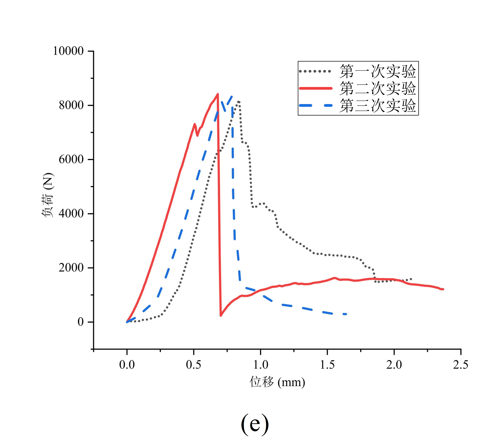 | 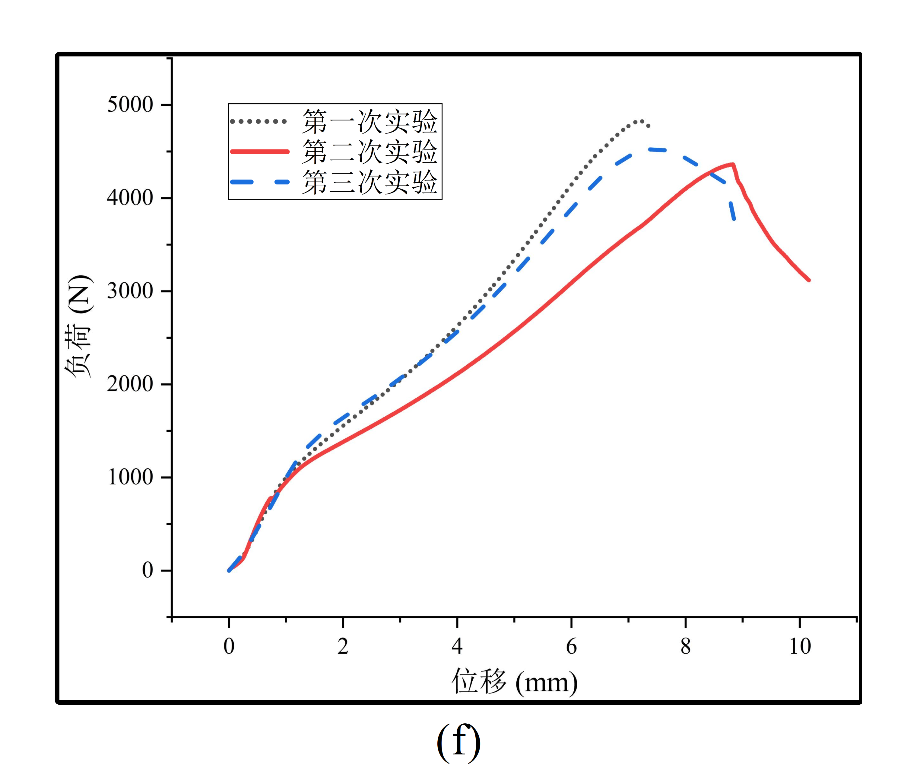 |

### 2.3 Material Comparison

| Average strength | Fiberglass | PTFE |
|---|---:|---:|
| Shear strength | 151.27 MPa | 57.54 MPa |
| Bending strength | 952.94 MPa | 25.40 MPa |
| Compressive strength | 294.06 MPa | 161.69 MPa |

Fiberglass exhibited higher measured strength across all three tests and was selected for subsequent greenhouse support-rod structural analysis. The results inform **material selection under the tested conditions**, rather than establishing the performance of every possible fiberglass or PTFE product.

## 3. Wind Resistance and Insertion Depth Analysis

The selected fiberglass support rods were evaluated using **ANSYS finite element analysis**. The study examined the response of a greenhouse arch under lateral wind loading and investigated the influence of the rod insertion depth on its equivalent stress and elastic strain.

### 3.1 Finite Element Model

The analysis used material parameters reported for the fiberglass rods, including an elastic modulus of **14.864 GPa**, Poisson's ratio **0.22**, and shear modulus **6.091 GPa**. The reported design wind pressure was **252 N/m²**.

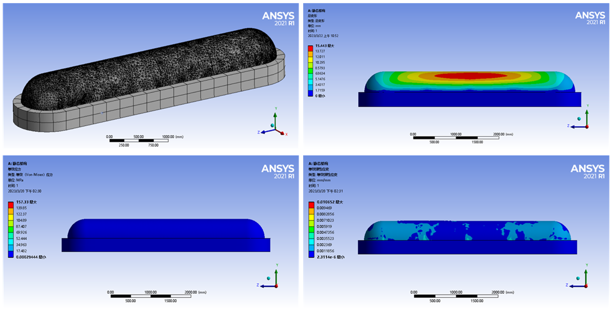

Finite element model and selected ANSYS analysis results.

### 3.2 Selecting the Insertion Depth

The study compared rod insertion depths from **8 to 20 cm**. As the insertion depth increased, the simulated equivalent stress and elastic strain generally decreased. The improvement became less pronounced beyond approximately **13 cm**, which was selected as the target insertion depth for the studied geometry and loading conditions.

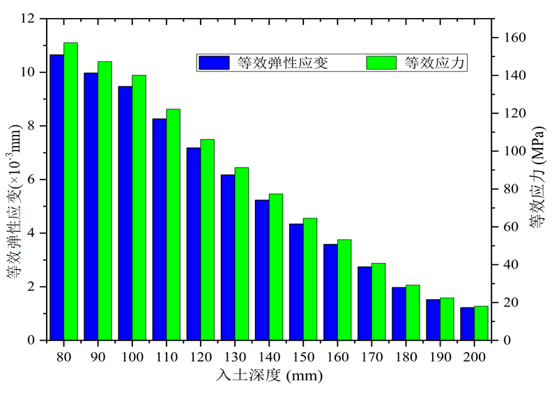

Effect of insertion depth on the simulated structural response.

**Design outcome: 13 cm target soil insertion depth**, under the assumptions of the reported simulation. This is a project-specific design decision, not a universal installation depth for all soils or wind conditions.

## 4. Prototype and Field Demonstration

A physical prototype was assembled and used in field trials to examine machine operation and greenhouse arch installation. The photographs and demonstrations below show the relationship between the proposed mechanism and the realized machine.

<table>
<tr>
<td width="50%">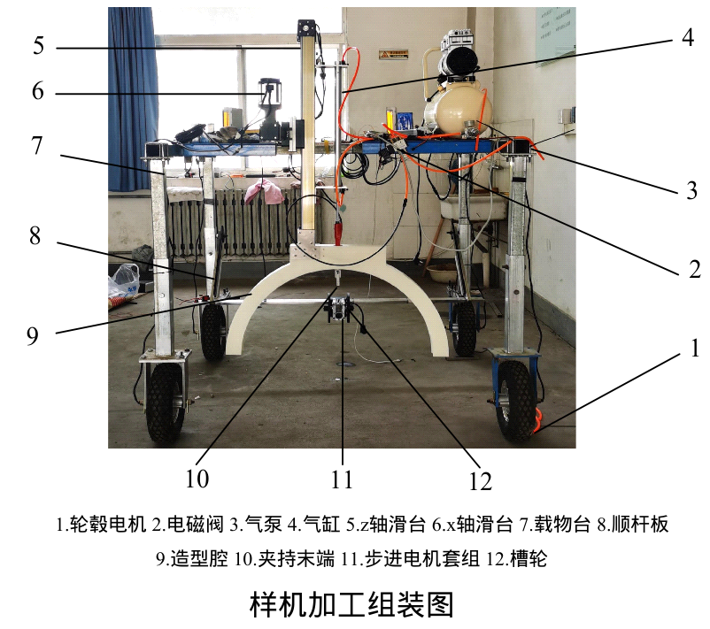 Prototype assembly.</td>
<td width="50%"> Field prototype and installed arches.</td>
</tr>
</table>

Field mobility demonstration.

---

*Project documentation: Figures and numerical results are based on the team’s project materials and associated mechanical design and experimental study. Control and autonomous driving were developed by other team members.*
