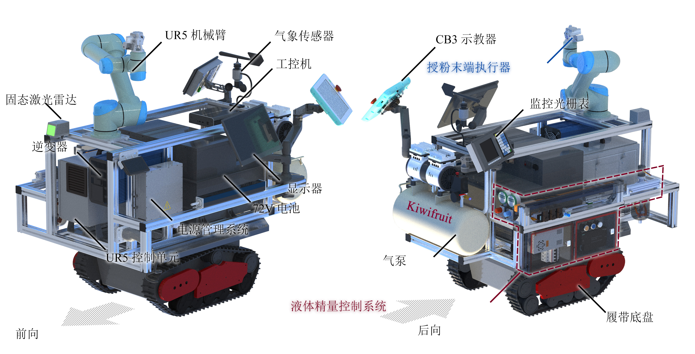
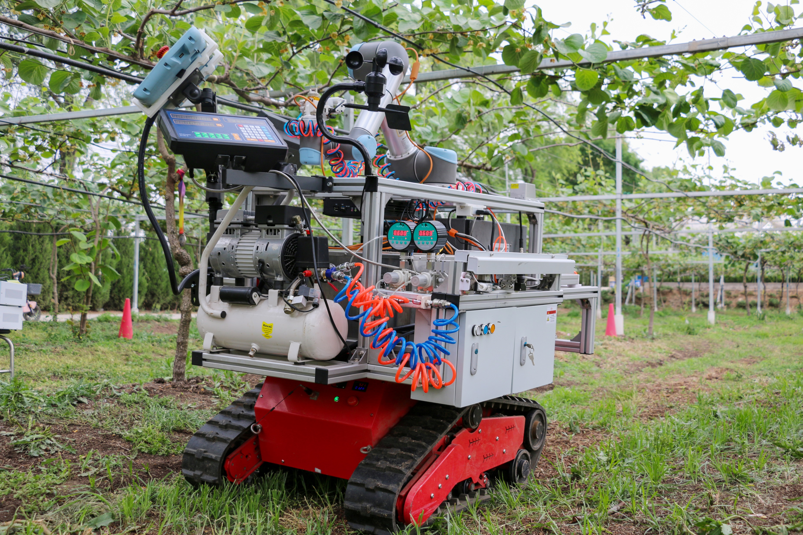
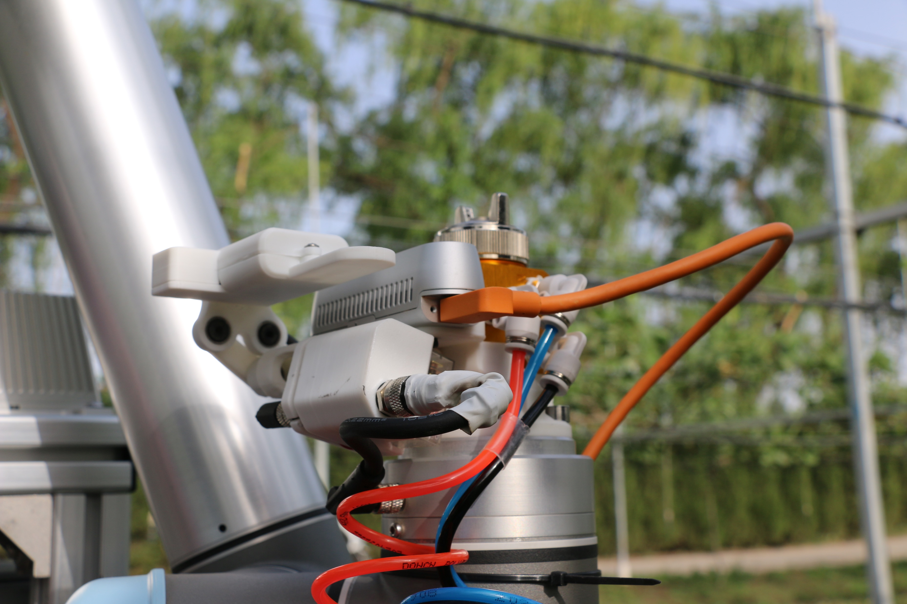
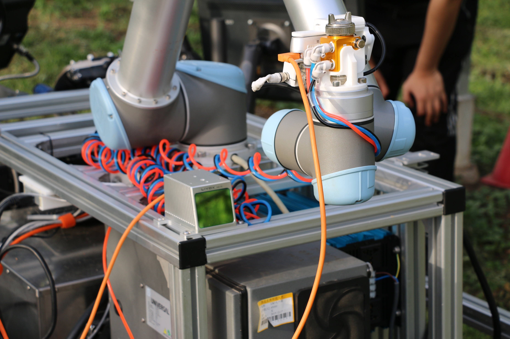
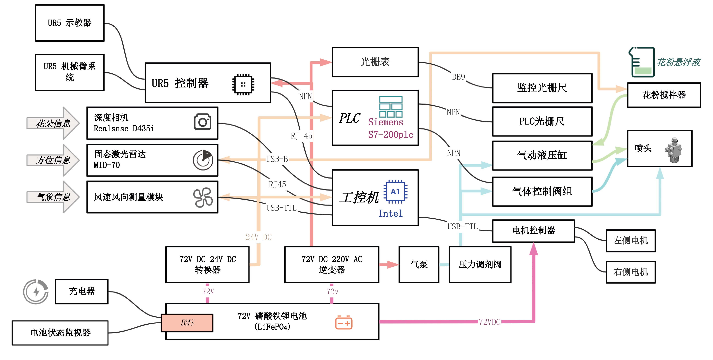
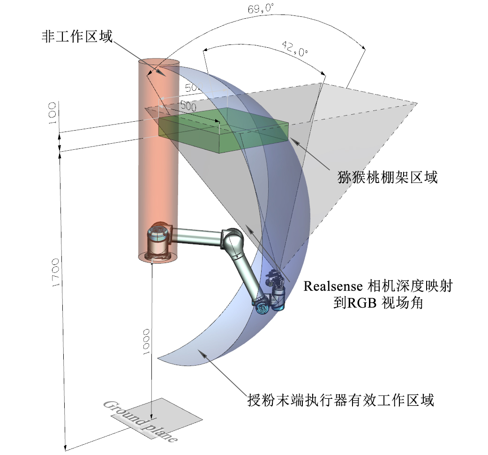
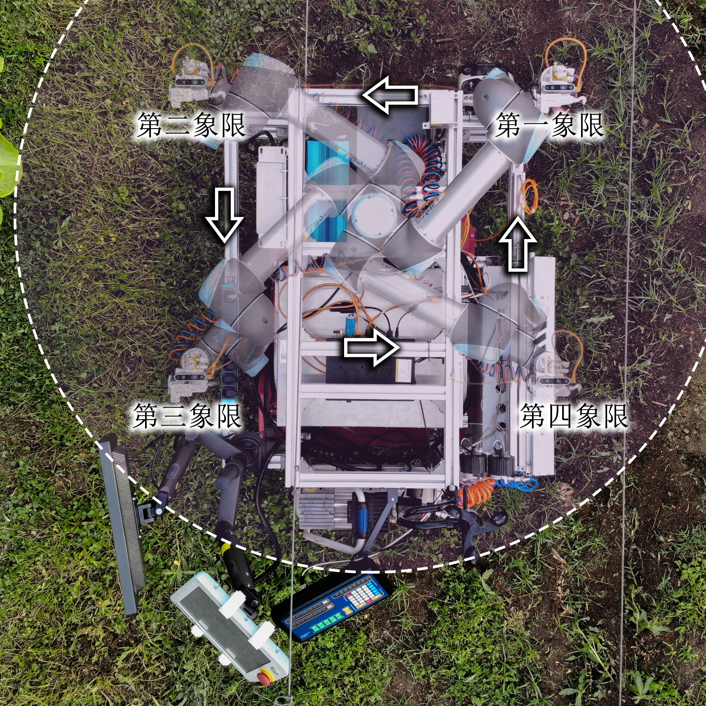
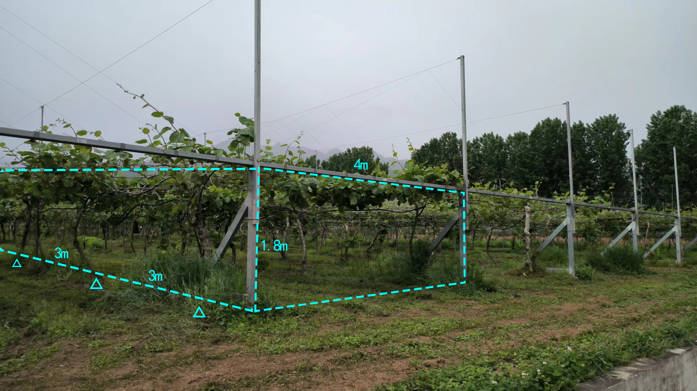
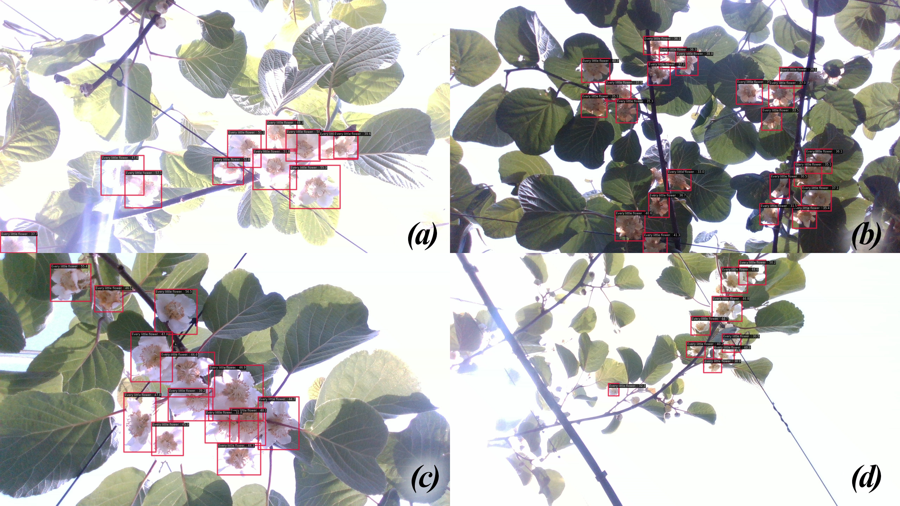

# Kiwifruit Pollination Robot

**Mechanical Design · Creo CAD · Prototype Integration · LiDAR Localization**  
*Undergraduate project | Northwest A&F University*

This project explored a tracked robotic platform for precision pollination in kiwifruit orchards. The system combined a UR5 robotic arm, a pollination end-effector, onboard sensing, and a mobile base for field operation.

My main contributions were **mechanical design with Creo**, the design and **3D printing of mounting components** for the nozzle and other hardware, **real-time robot localization work using Livox MID-70 LiDAR**, and **annotation of kiwifruit flowers** for computer-vision experiments. The overall robot and control architecture were developed as part of a team project.

## Prototype and Mechanical Design

*Robot system CAD overview, showing the integrated arm, sensors, and tracked platform.*

*Assembled robot during orchard experiments.*

I worked on Creo-based component modeling, mechanical layout, mounting solutions, and prototype integration. Several fixtures, including nozzle-related mounts, were fabricated using 3D printing.

<table>
<tr>
<td width="50%"> Pollination end-effector detail</td>
<td width="50%"> Robot arm and sensor integration</td>
</tr>
</table>

## Control System Architecture

The robot integrates a UR5 robotic arm, Livox MID-70 LiDAR,
RGB-D camera, industrial computer, and PLC-based control system.

## Mechanical Workspace

<table>
<tr>
<td width="50%"> CAD workspace analysis</td>
<td width="50%"> Arm operating regions</td>
</tr>
</table>

## SLAM — LiDAR-Based Localization and Mapping

I explored real-time localization of the mobile robot using **Livox MID-70 LiDAR**, in support of operation in the repetitive structure of kiwifruit orchards.

*Representative orchard environment and row geometry.*

### SLAM Demonstration

Real-time LiDAR-based SLAM using the Livox MID-70 sensor.

[Watch the SLAM demonstration](videos/slam.mp4)

## Kiwifruit Flower Annotation

I also annotated kiwifruit flowers in orchard imagery for visual detection experiments.

*Example images showing flower detection annotations; this figure is not presented as a stand-alone model performance evaluation.*

Real-time LiDAR localization using the Livox MID-70 sensor.

<video src="videos/slam.mp4" controls width="100%"></video>

[Watch the demonstration](videos/slam.mp4)
<!-- SLAM_DEMO_END -->

<!-- ROBOT_WORKING_DEMO_START -->
## Robot Working Demo

Field demonstration of the kiwifruit pollination robot.

<video src="videos/working%20video.mp4" controls width="100%"></video>

[Watch the robot working video](videos/working%20video.mp4)
<!-- ROBOT_WORKING_DEMO_END -->
