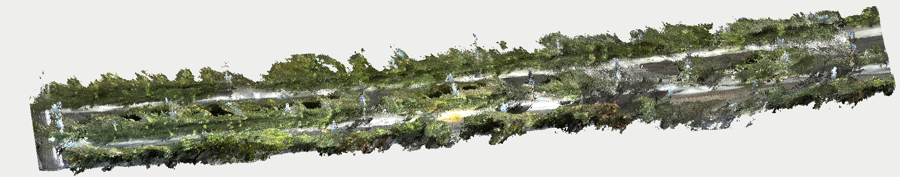
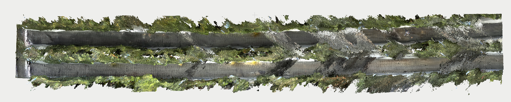
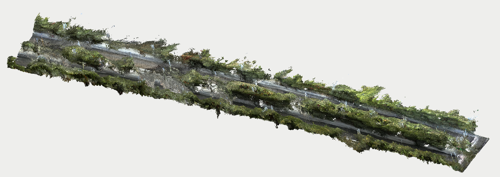

# RGB-D-Based 3D Reconstruction of Agricultural Environments

**RGB-D · Visual SLAM · GNSS Alignment · Colored Point Clouds**  
*Robotics Perception | Agricultural Environment Reconstruction*

## Project Overview

This project reconstructs large-scale agricultural environments from RGB-D observations using my self-developed **Visual SLAM system** and **GNSS-based global alignment**. RGB images provide appearance information, while depth observations provide metric geometry for colored point-cloud reconstruction.

## Reconstruction Pipeline

1. **RGB-D back-projection:** Valid depth pixels are projected into 3D using calibrated camera intrinsics, with RGB values assigned to the corresponding points.
2. **Visual SLAM pose estimation:** The Visual SLAM system estimates camera poses, allowing sequential RGB-D point clouds to be transformed and fused into a consistent local map.
3. **Multi-session reconstruction:** Multiple ROS bag datasets are processed individually to produce separate point-cloud maps.
4. **GNSS-based global alignment:** GNSS positioning data is used to align and merge those maps into a shared global coordinate frame.

The result is a **large-scale colored point-cloud reconstruction** preserving both the scene structure and visual appearance of the agricultural environment.

## Reconstruction Results

  

  

  

### Reconstruction Animation

[Watch the 3D reconstruction animation (MP4)](video/animation.mp4)

## Applications

The reconstructed map provides a geometric and visual representation for future work in **agricultural robotic perception, autonomous navigation, and digital twins**.
