# Depth-Supervised 3D Gaussian Splatting

**3D Reconstruction · Confidence-Weighted Depth Supervision · Geometric Consistency**  
*Research Project | Field Robotics Laboratory, Kyoto University*

## Project Overview

3D Gaussian Splatting (3DGS) enables photorealistic, efficient novel-view rendering, but visual quality does not guarantee reliable geometry. I explored **confidence-weighted D435 depth supervision** to improve agreement with measured depth while preserving rendering quality.

## 1. Background and Motivation

Point clouds, meshes, and voxels have different trade-offs in surface representation and efficiency. 3DGS produces visually detailed scenes using explicit Gaussians, yet RGB-only photometric optimization may leave depth and surface geometry inaccurate.

### Photometric Optimization — L1 and SSIM

Standard 3DGS combines pixel-wise **L1 loss** and local **SSIM**. In the illustration, white boxes indicate L1 pixel comparison regions, while green markings highlight local structural comparison for SSIM. Neither loss directly guarantees metric geometry.

  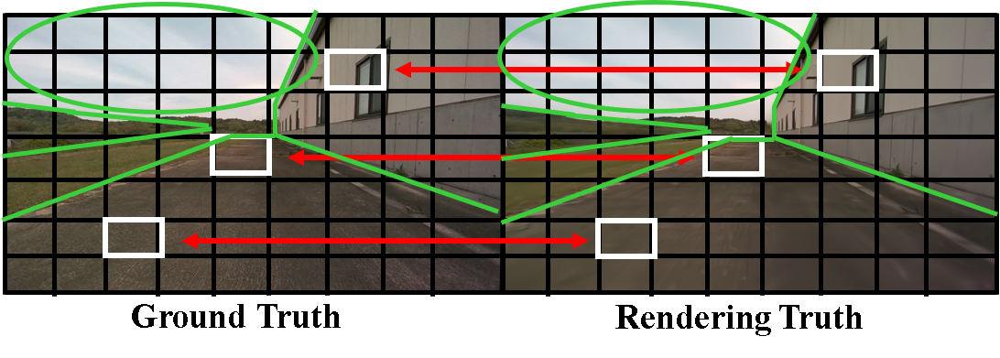

<em>Illustration of L1 (white) and SSIM (green) photometric supervision.</em>

  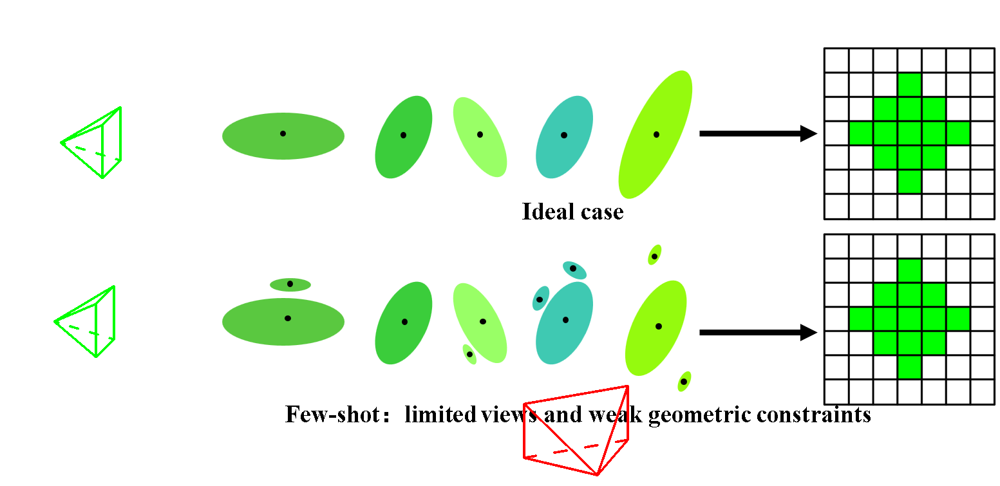

<em>Illustrative Gaussian artifacts; not a quantitative overfitting experiment.</em>

## 2. Reconstruction Pipeline

The workflow uses RGB images, calibrated **Intel RealSense D435** depth, and COLMAP-initialized camera poses. Because monocular SfM has an arbitrary scale, **metric scale recovery** is necessary before comparing rendered depth with D435 depth in meters.

  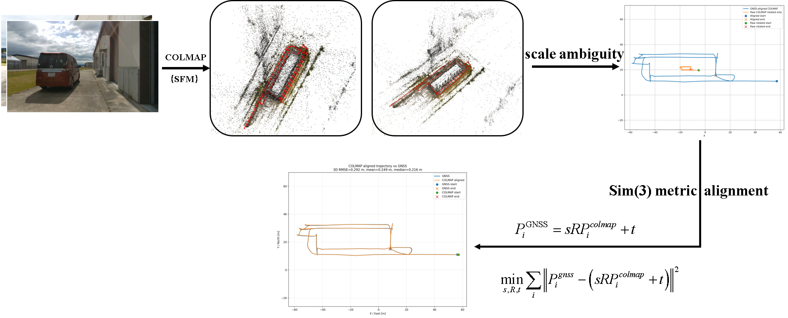

<em>Overall RGB-D and depth-supervision pipeline.</em>

### Depth Mask and Confidence

Invalid depth pixels are filtered out. Valid observations receive confidence weights based on **edges, texture, depth gradients, and distance**.

  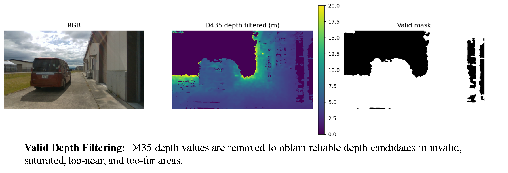

<em>RGB input, D435 depth, and valid-depth mask.</em>

  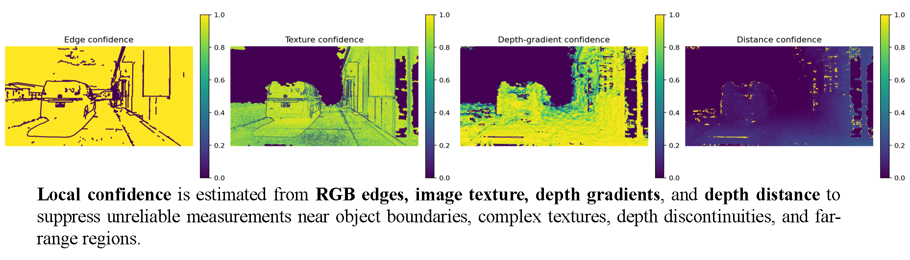

<em>Single-view reliability cues.</em>

Single-view confidence (V7) is combined with multi-view geometric consistency (V8): **Final Confidence = V7 × V8**.

  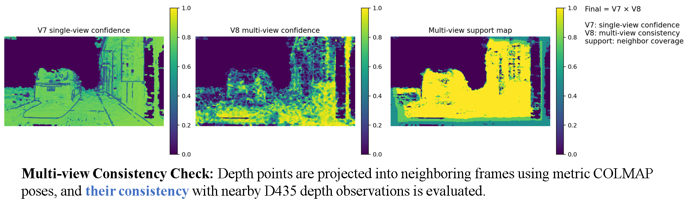

<em>Single-view confidence, multi-view confidence, and support coverage.</em>

  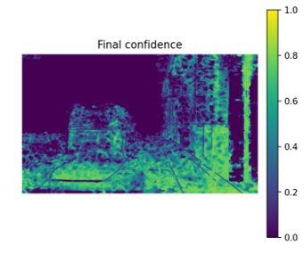

<em>Final confidence map used to weight the depth constraint.</em>

## 3. Scale Recovery and Visual Demonstrations

Scale recovery puts COLMAP/3DGS depth and D435 observations into a common **metric scale** for depth supervision and evaluation.

  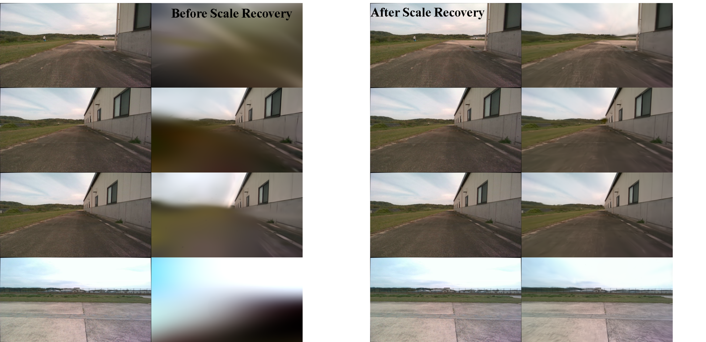

<em>Views before and after scale recovery; this is not a depth-supervision ablation.</em>

**RGB-only:** [Watch reconstruction video](videos/rgb-only.mp4)  
**Depth-supervised:** [Watch reconstruction video](videos/depth-supervised.mp4)

## 4. Rendering Quality Evaluation

  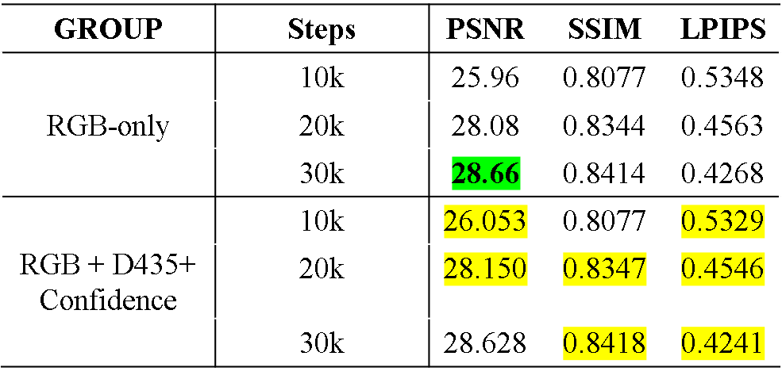

<em>PSNR, SSIM, and LPIPS over training iterations.</em>

At 30k steps, depth supervision preserved **comparable rendering quality** (PSNR 28.660 → 28.628 dB; SSIM 0.8414 → 0.8418).

## 5. Depth Consistency Evaluation

Rendered depth from both models was compared against **D435 observed depth**, using RMSE (meters; lower is better).

  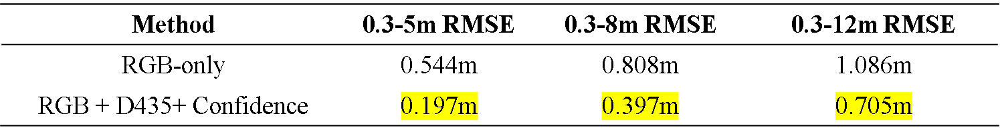

<em>Depth RMSE relative to D435 measurements; improvement decreases with distance. This demonstrates **sensor-depth consistency**, not independent ground-truth 3D accuracy.</em>

## 6. Future Work — SLAM-Based Initialization

I am extending the workflow toward **LiDAR–Inertial–Visual Odometry (LIVO)**, aiming to replace offline COLMAP initialization with continuous metric camera poses and LiDAR geometry for future 3DGS mapping.

  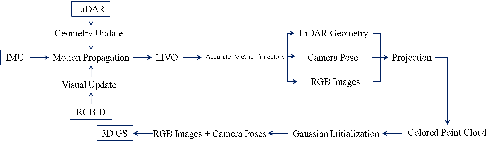

<em>Planned SLAM-based initialization for 3DGS; ongoing work.</em>

